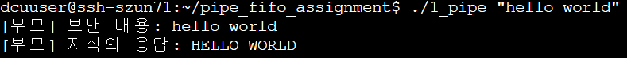
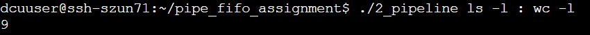
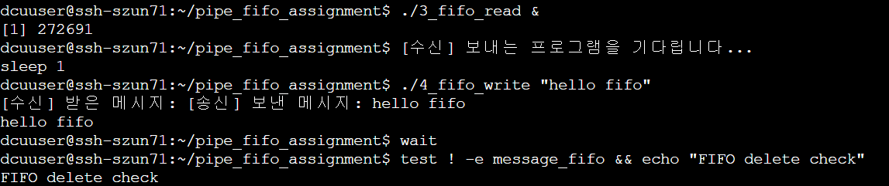

# 7주차 실습 과제 — 파이프와 FIFO

## 1. 프로젝트 설명

`code07.zip`의 **C언어 기본 예제 4개**를 바탕으로 `pipe()`, `fork()`, `dup2()`, `execvp()`, `mkfifo()`를 실습한 프로젝트이다.

- **1번**: 두 개의 파이프를 이용해 부모가 보낸 문자열을 자식이 대문자로 변환하고 부모에게 준다.
- **2번**: `:`로 구분한 두 명령어를 `dup2()`와 `execvp()`로 연결한다.
- **3번**: 독립적으로 실행한 송신·수신 프로그램이 FIFO를 통해 문자열을 전달한다.

## 2. 원본 코드에서 변경한 사항

| 원본코드 | 수정한 내용 |
|---|---|
| `1_pipe_basic.c`: 파이프 1개, 부모에서 자식으로 고정 문자열만 전송 | 파이프 2개를 사용해 왕복하고, 명령행 인자를 받아 자식이 `toupper()`로 대문자 변환 |
| `2_pipe_dup2.c`: `ls`와 `wc -l`이 고정 | 명령행의 `:`를 기준으로 두 명령어를 나누고 `execvp()`로 실행 |
| `3_fifo_read.c`: FIFO에서 한 번 읽기 | FIFO 경로를 현재 디렉터리로 변경, 반복 읽기로 긴 메시지도 처리, 종료 시 `unlink()`로 삭제 |
| `4_fifo_write.c`: 기본 문자열도 허용하는 송신 | 메시지를 명령행 인자로 받도록 사용법을 명확히 하고 수신 프로그램과 동일한 FIFO 경로 사용 |

## 3. 컴파일
각 프로그램은 다음과 같이 컴파일하였다.

```bash
gcc -Wall -Wextra 1_pipe_basic.c -o 1_pipe
gcc -Wall -Wextra 2_pipe_dup2.c -o 2_pipeline
gcc -Wall -Wextra 3_fifo_read.c -o 3_fifo_read
gcc -Wall -Wextra 4_fifo_write.c -o 4_fifo_write
```

## 4. 실행 방법 및 결과

### ① 파이프 왕복 통신
**파일:** [1_pipe_basic.c](1_pipe_basic.c)

실행 명령과 실행결과



사용하지 않는 파이프 끝을 닫고, 부모가 쓰기 끝을 닫아 자식이 EOF를 감지하도록 하였다.

### ② dup2로 명령 이어 붙이기
**파일:** [2_pipe_dup2.c](2_pipe_dup2.c)

실행 명령과 실행결과



`ls -l` 명령어로 현재 폴더의 파일 목록을 출력하고, 그 결과를 `wc -l` 명령어로 전달하여 줄 수를 계산하도록 하였다. 실행 결과 9가 출력되는 것을 확인하였다.

### ③ FIFO를 이용한 메시지 송수신
**파일**
- [3_fifo_read.c](3_fifo_read.c): 메시지 수신
- [4_fifo_write.c](4_fifo_write.c): 메시지 송신

실행 명령과 실행결과



FIFO를 이용하여 송신 프로그램에서 보낸 `hello fifo` 메시지를 수신 프로그램에서 받는 것을 확인하였다. 통신이 끝난 후 `test ! -e message_fifo` 명령어로 FIFO 파일이 삭제된 것도 확인하였다.

## 5. AI 사용 내용
이번 과제에서 AI를 활용하여 다음과 같은 도움을 받았다.

* pipe()를 이용한 부모-자식 간 왕복 통신 코드 구조 작성 도움
* dup2()를 이용한 두 명령어의 표준입출력 연결 코드 구조 작성 도움
* FIFO를 이용한 메시지 송수신 및 unlink()를 통한 파일 삭제 코드 구조 작성 도움
* README.md의 가독성을 높이기 위해 Markdown 문법과 문서 형식 수정 도움

AI가 제시한 수정 코드와 예시를 참고하여 Linux 환경에서 직접 컴파일하고 실행하였다. 각 프로그램의 실행 결과를 확인하고, 명령어와 출력 결과의 의미를 이해하는 데 도움을 받았다.

**사용한 AI 질문 예시**
* 파이프 2개를 이용하여 부모와 자식이 문자열을 주고받는 C 프로그램의 코드 구조를 알려줘.
* dup2()를 이용해서 두 명령어를 연결하는 프로그램의 코드 구조를 알려줘.
* FIFO를 이용해 메시지를 주고받고 통신 종료 후 FIFO 파일을 삭제하는 방법을 알려줘.
* README.md에서 표를 작성할 수 있는 Markdown 문법을 알려줘.

## 6. 본인이 보강한 내용

AI의 도움을 받은 후 직접 Linux 환경에서 코드를 컴파일하고 실행하여 동작을 확인하였다.

* `gcc -Wall -Wextra`를 사용하여 C 파일 4개를 오류 없이 컴파일하였다.
* `./1_pipe "hello world"`를 실행하여 자식이 문자열을 대문자로 변환한 후 부모에게 반환하는 것을 확인하였다.
* `./2_pipeline ls -l : wc -l`을 실행하여 두 명령어가 연결되고 결과로 9가 출력되는 것을 확인하였다.
* `./3_fifo_read &`와 `./4_fifo_write "hello fifo"`를 실행하여 FIFO를 통한 메시지 송수신을 확인하였다.
* `test ! -e message_fifo` 명령어를 이용하여 통신 종료 후 FIFO 파일이 삭제된 것을 확인하였다.
* 각 프로그램의 실행 결과를 캡처하고 README.md에 실행 방법과 결과를 정리하였다.


## 7. 최종 파일
```
pipe_fifo_assignment/
├── 1_pipe_basic.c
├── 1_pipe.png
├── 2_pipe_dup2.c
├── 2_pipeline.png
├── 3_fifo_read.c
├── 4_fifo_write.c
├── 3_fifo.png
└── README.md
```

